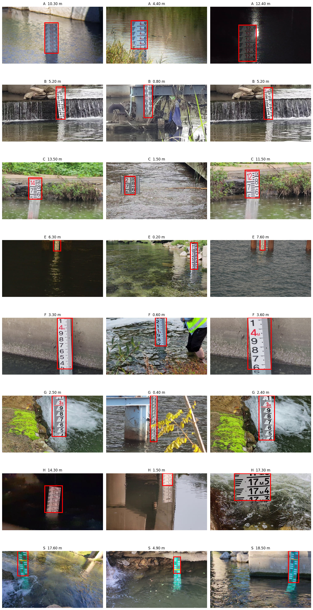
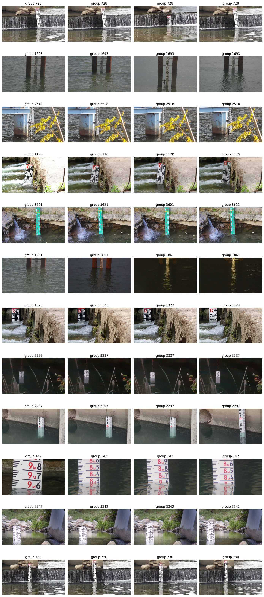
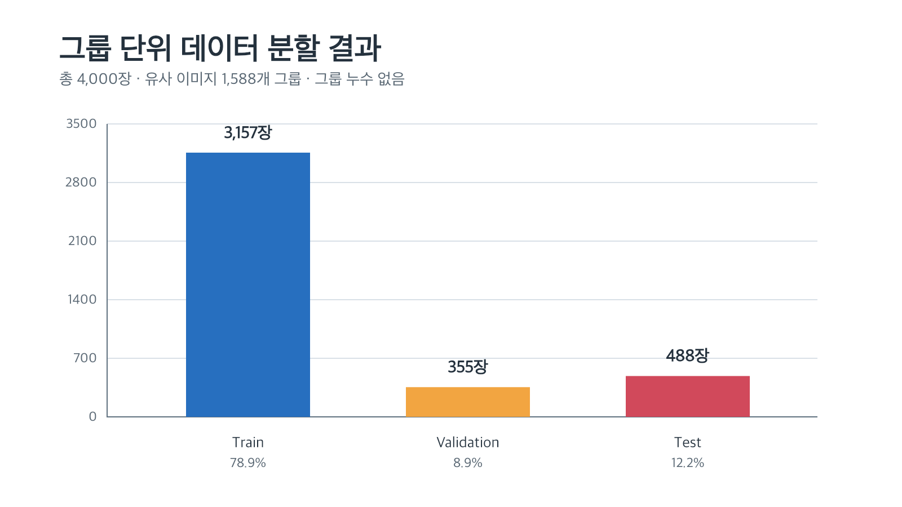
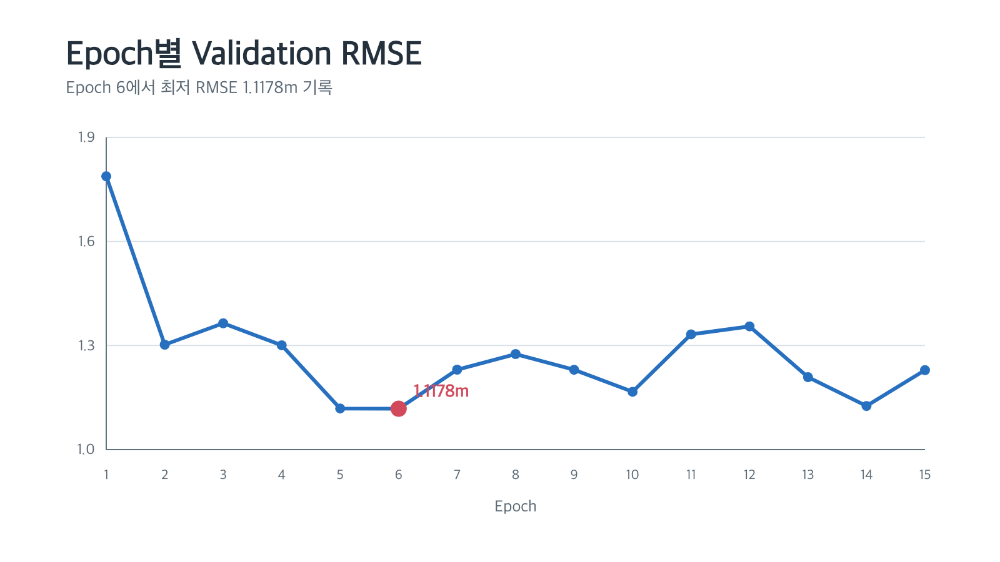
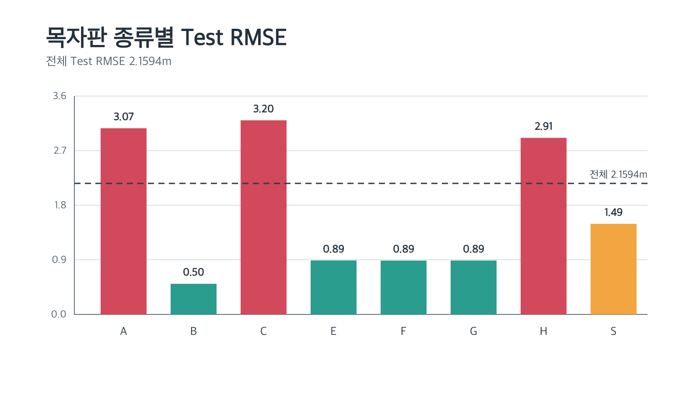
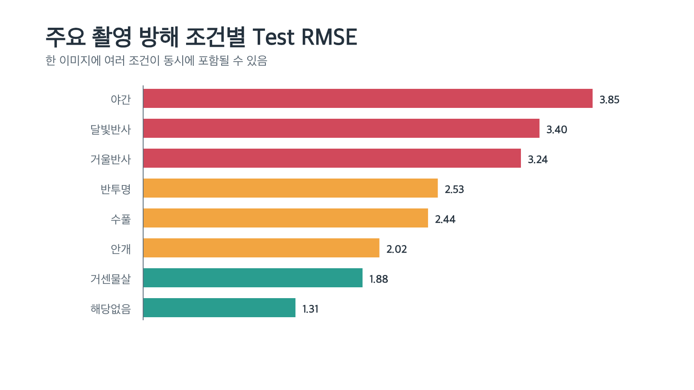
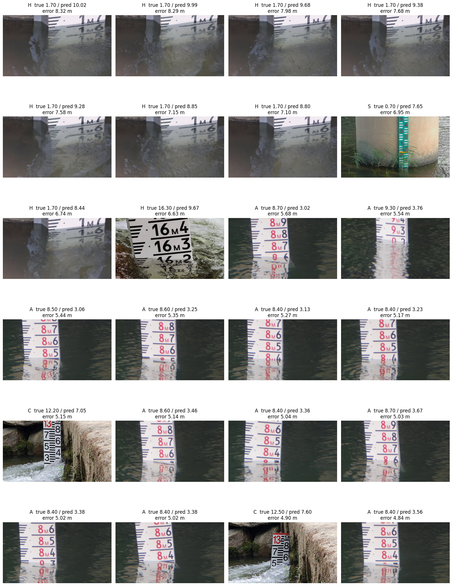

# 이미지 기반 목자판 수위 예측 AI

데이터+AI 크리에이터 캠프 고등부 예선 프로젝트임.  
수위 측정 이미지와 목자판 종류를 이용하여 실제 수위(m)를 예측하는 회귀 모델을 개발함.

## 프로젝트 정보

- 참가 부문: 데이터+AI 크리에이터 캠프 고등부
- 사용 모델: EfficientNet-B0
- 개발 환경: Google Colab, PyTorch, T4 GPU

## 1. 프로젝트 목표

수위 측정 이미지를 AI 모델이 분석하여 실제 수위를 자동으로 예측하도록 구현함.

- 입력값: 수위 측정 이미지, 목자판 종류
- 출력값: 실제 수위(m)
- 문제 유형: 회귀
- 주요 평가 지표: RMSE

실제 수위는 정해진 등급이 아닌 연속적인 수치이므로 분류가 아닌 회귀 문제로 정의함.

목자판 종류는 실제 수위를 직접 알려주는 정답이 아니라, 서로 다른 형태의 목자판을 구분하기 위한 보조 정보로 사용함.

## 2. 데이터 구성

전체 데이터는 원천 이미지와 이미지별 JSON 라벨 파일로 구성됨.

- 전체 원천 이미지: 308,085장
- 전체 JSON 라벨: 308,085개
- 이미지 또는 JSON 누락 사례: 0건
- 목자판 종류: A, B, C, E, F, G, H, S

JSON에는 실제 수위, 목자판 종류, 바운딩박스 및 촬영 방해 조건 등의 정보가 저장되어 있음.

본 실험에서는 Colab 환경과 저장 공간을 고려하여 목자판 종류별 500장씩 총 4,000장을 사용함.

> 캠프에서 제공한 원본 데이터와 실험용 데이터는 용량 및 이용 조건으로 인해 저장소에 포함하지 않음.

## 3. 데이터 확인

이미지와 JSON의 파일명을 비교하여 일대일 대응 여부를 확인함.

- 실험 이미지: 4,000장
- 실험 JSON: 4,000개
- 라벨이 없는 이미지: 0장
- 이미지가 없는 라벨: 0개

JSON의 바운딩박스를 실제 이미지 위에 표시하여 목자판 위치가 올바르게 지정되었는지 확인함.

<details>
<summary>바운딩박스 시각화 보기</summary>



</details>

## 4. 유사 이미지 그룹화

동일한 장소나 촬영 세션에서 촬영된 유사 이미지가 Train과 Test에 함께 포함되면 모델이 배경이나 촬영 환경을 암기할 수 있음.

이 경우 Test 성능이 실제보다 높게 측정될 수 있으므로 시각적으로 유사한 이미지를 하나의 그룹으로 구성함.

### 그룹화 방법

1. perceptual hash로 이미지 특징을 해시값으로 변환함.
2. Hamming 거리로 이미지 사이의 유사도를 측정함.
3. BK-tree로 가까운 해시값을 탐색함.
4. Union-Find로 서로 연결된 이미지를 같은 그룹으로 통합함.
5. 동일 그룹이 여러 subset에 포함되지 않도록 분할함.

### 그룹화 결과

- 전체 이미지: 4,000장
- 생성 그룹: 1,588개
- 그룹당 평균 이미지: 약 2.52장
- 그룹 크기 중앙값: 1장
- 최대 그룹 크기: 63장

<details>
<summary>유사 이미지 그룹 예시 보기</summary>



</details>

## 5. 데이터 분할

| Subset | 이미지 수 | 비율 |
|---|---:|---:|
| Train | 3,157 | 78.9% |
| Validation | 355 | 8.9% |
| Test | 488 | 12.2% |
| 합계 | 4,000 | 100% |

- 동일 유사 이미지 그룹은 하나의 subset에만 포함함.
- 그룹 누수가 없음을 확인함.
- Test 데이터는 학습과 모델 선택에 사용하지 않음.



## 6. 모델 선정

다음 모델을 후보로 검토함.

| 모델 | 특징 |
|---|---|
| ResNet50 | 구조가 비교적 단순하며 기준 모델로 사용하기 적절함 |
| EfficientNet-B0 | 계산량 대비 성능이 우수하고 제한된 환경에서 학습하기 적합함 |
| ConvNeXt-Tiny | 높은 성능을 기대할 수 있으나 계산 부담이 비교적 큼 |

최종 모델로 EfficientNet-B0을 선정함.

- 제한된 Colab 환경에서 비교적 효율적으로 학습할 수 있음.
- ImageNet 사전 학습 가중치를 활용할 수 있음.
- 모델 크기와 기대 성능 사이의 균형이 적절함.

## 7. 모델 구성 및 학습

EfficientNet-B0으로 이미지 특징을 추출함. 목자판 종류 정보를 숫자로 변환한 후 이미지 특징과 결합하여 실제 수위를 예측함.

### 학습 환경

- Google Colab
- T4 GPU
- Python
- PyTorch
- EfficientNet-B0
- 전이학습 사용
- 총 15 Epoch 학습
- Random seed: 42

### 목자판 종류 변환

| 목자판 | 변환값 |
|---|---:|
| A | 0 |
| B | 1 |
| C | 2 |
| E | 3 |
| F | 4 |
| G | 5 |
| H | 6 |
| S | 7 |

## 8. Validation 결과

- Epoch 1 Validation RMSE: 1.7878m
- 최고 Validation RMSE: 1.1178m
- 최고 성능 Epoch: 6
- Epoch 15 Validation RMSE: 1.2291m

Epoch 1부터 Epoch 6까지 Validation RMSE가 약 0.6700m 감소함. 모델이 이미지와 실제 수위 사이의 관계를 학습했음을 확인함.

Epoch 6 이후에는 RMSE가 지속해서 감소하지 않고 변동함. 최종 Test 평가에는 마지막 Epoch 모델이 아닌 Validation RMSE가 가장 낮았던 Epoch 6 모델을 사용함.



## 9. Test 결과

### 전체 성능

- 전체 Test RMSE: **2.1594m**
- 최고 Validation RMSE: **1.1178m**
- Validation과 Test RMSE 차이: 약 1.0416m

Test RMSE가 Validation RMSE보다 높게 나타남. 모델이 학습 과정에서 접한 환경보다 새로운 장소와 촬영 조건에서 더 큰 어려움을 겪은 것으로 판단함.

이번 Test 데이터는 유사 이미지 그룹을 기준으로 분리했기 때문에 단순 무작위 분할보다 평가 난도가 높지만, 새로운 환경에서의 성능을 확인하는 목적에 적합함.

## 10. 목자판 종류별 성능

| 목자판 종류 | Test RMSE(m) |
|---|---:|
| A | 3.0691 |
| B | **0.5045** |
| C | 3.2003 |
| E | 0.8897 |
| F | 0.8870 |
| G | 0.8880 |
| H | 2.9109 |
| S | 1.4932 |

B형에서 가장 낮은 RMSE를 기록함. C형에서 가장 높은 RMSE가 나타났으며 A형과 H형에서도 비교적 큰 오차가 발생함.

목자판 종류별 데이터 분포와 촬영 환경의 차이가 모델 성능에 영향을 준 것으로 판단함.



## 11. 촬영 방해 조건별 성능

| 촬영 조건 | Test RMSE(m) |
|---|---:|
| 야간 | **3.8517** |
| 달빛반사 | 3.3964 |
| 거울반사 | 3.2372 |
| 반투명 | 2.5250 |
| 수풀 | 2.4414 |
| 안개 | 2.0246 |
| 거센물살 | 1.8801 |
| 해당없음 | 1.3053 |

야간 조건에서 가장 큰 오차가 발생함. 달빛반사와 거울반사 조건에서도 높은 RMSE가 나타남.

방해 조건이 없는 이미지의 RMSE는 1.3053m로 나타남. 어두운 조명, 빛 반사 및 목자판을 가리는 요소가 수위 예측 성능을 저하하는 주요 원인으로 판단함.

촬영 방해 조건은 다중 라벨이므로 한 이미지가 여러 조건에 동시에 포함될 수 있음. 조건별 데이터 수도 다르므로 RMSE를 해석할 때 표본 수를 함께 고려해야 함.



## 12. 오차 사례 분석

Test 데이터에서 절대오차가 큰 사례를 분석함.

### H형 사례

- 촬영군: H_0007
- 실제 수위: 1.7m
- 예측 수위: 약 8.4~10.0m
- 최대 절대오차: 8.3221m
- 주요 조건: 야간, 반투명

### A형 사례

- 촬영군: A_0510
- 실제 수위: 약 8.4~9.3m
- 예측 수위: 약 3.0~3.8m
- 주요 조건: 거울반사, 반투명

### 기타 사례

- C형의 거센 물살과 수풀 조건에서 약 5m의 오차가 발생함.
- S형의 반투명과 수풀 조건에서 약 6.95m의 오차가 발생함.
- 방해 조건이 없는 H형 이미지에서도 약 6.63m의 오차가 발생함.

특정 촬영 장소와 환경에서 비슷한 방향의 오차가 반복됨. 모델이 목자판 눈금보다 배경, 조명 또는 촬영 환경의 영향을 받았을 가능성이 있음.

<details>
<summary>주요 오차 사례 보기</summary>



</details>

## 13. 결론

수위 측정 이미지와 목자판 종류를 이용하여 실제 수위를 예측하는 EfficientNet-B0 기반 회귀 모델을 구현함.

perceptual hash 기반 이미지 그룹화를 적용하여 유사한 사진이 Train과 Test에 동시에 포함되는 문제를 방지함. 그룹 단위 분할 결과 그룹 누수가 없음을 확인함.

4,000장의 실험용 데이터로 학습한 결과 Epoch 6에서 Validation RMSE 1.1178m를 기록함. 새로운 유사 이미지 그룹으로 구성된 Test 데이터에서는 전체 RMSE 2.1594m를 기록함.

B형 목자판에서는 비교적 우수한 성능을 보였지만 A형, C형, H형에서는 큰 오차가 발생함. 야간과 반사 조건에서도 성능이 크게 저하됨.

모델이 기본적인 수위 예측 특징은 학습했지만, 새로운 장소와 어려운 촬영 환경에 대한 일반화 성능은 추가로 개선할 필요가 있음.

## 14. 한계점 및 개선 방향

### 한계점

- 전체 308,085장이 아닌 4,000장의 표본 데이터만 사용함.
- 목자판 종류별 수위 분포가 균등하지 않을 수 있음.
- 이미지 유사도만으로 실제 촬영 장소를 완벽하게 구분하기 어려움.
- 야간과 반사 조건의 학습 데이터가 충분하지 않을 수 있음.
- 전체 이미지를 입력하여 배경의 영향을 받았을 가능성이 있음.
- 한 번의 데이터 분할과 학습 결과만 확인함.

### 개선 방향

- 전체 데이터를 활용하여 모델을 학습함.
- A형, C형, H형 데이터를 추가로 분석하고 보강함.
- 야간과 반사 조건을 고려한 데이터 증강을 적용함.
- 바운딩박스로 목자판 영역을 잘라 학습함.
- 전체 이미지와 목자판 부분 이미지를 함께 입력함.
- 목자판 종류별 수위 분포를 고려하여 표본을 구성함.
- Early Stopping을 적용함.
- 여러 데이터 분할에서 반복 실험함.

## 15. 저장소 구조

```text
.
├── README.md
├── notebook/
│   └── DCC_고등부_예선_답안.ipynb
├── report/
│   └── 예선_서면보고서.pptx
└── assets/
    ├── 01_바운딩박스_시각화.jpg
    ├── 02_유사이미지_그룹_예시.jpg
    ├── 03_데이터_분할_그래프.png
    ├── 04_Validation_RMSE_그래프.png
    ├── 05_목자판별_Test_RMSE.png
    ├── 06_촬영조건별_Test_RMSE.png
    └── 07_오차사례_이미지.jpg
```

## 16. 실행 방법

1. `notebook/DCC_고등부_예선_답안.ipynb`를 Google Colab에서 실행함.
2. Google Drive에 실험용 데이터 ZIP을 업로드함.
3. 노트북의 데이터 경로를 실제 Drive 경로에 맞게 수정함.
4. `런타임 → 런타임 유형 변경 → T4 GPU`를 선택함.
5. 코드 셀을 위에서 아래 순서대로 실행함.
6. 학습 전 `device: cuda`가 출력되는지 확인함.

### 주요 라이브러리

```text
torch
torchvision
timm
pandas
numpy
matplotlib
Pillow
imagehash
scikit-learn
```

## 17. 데이터 안내

캠프에서 제공한 원본 데이터와 실험용 데이터는 저장소에 포함하지 않음.

실행 시 다음 구조로 데이터가 필요함.

```text
data/
├── images/
└── labels/
```

이미지와 JSON 라벨은 확장자를 제외한 파일명이 동일해야 함.

## 18. 주요 파일

- 실행 코드 및 결과: `notebook/DCC_고등부_예선_답안.ipynb`
- 예선 서면 보고서: `report/예선_서면보고서.pptx`
- 그래프 및 분석 이미지: `assets/`